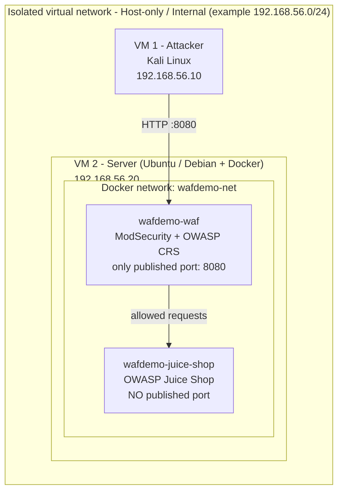
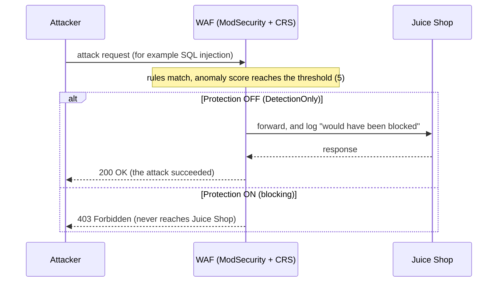

# Implimentation of Web-Application Firewall(WAF)


A web security project focused on implementing and configuring a Web Application Firewall (WAF) to filter malicious traffic and protect web applications against attacks such as SQL injection and cross-site scripting (XSS).

## Architecture

Two virtual machines on one isolated network. The attacker can only reach the shop **through the WAF**.



Direct access to Juice Shop on port 3000 is impossible by design, because that port is never published.

What happens to an attack request:



| Container | Image | Role |
|---|---|---|
| `wafdemo-waf` | `owasp/modsecurity-crs:nginx` | nginx reverse proxy with ModSecurity and the OWASP Core Rule Set. The **only** published port (default `8080`). |
| `wafdemo-juice-shop` | `bkimminich/juice-shop` | The intentionally vulnerable target. **No** published port. |

## Requirements

| Where | Needs |
|---|---|
| Host computer | A hypervisor (VirtualBox, VMware, Proxmox or KVM) with an isolated Host-only / Internal network. Recommended: 4+ cores, 8+ GB RAM. |
| **VM 2 (Server)** | Ubuntu Server or Debian, **Python 3.7+**, 2 vCPU, 4 GB RAM, 20 GB disk (recommended). Docker and Docker Compose v2 are installed automatically if missing. |
| **VM 1 (Attacker)** | Kali Linux (or any Linux with `curl`, `sqlmap`, `nikto` and a browser). |
| Network | Both VMs on the **same Host-only / Internal network** with static IPs. VM 2 needs **temporary** internet access (a NAT adapter) for the first setup only, to download Docker and the two images. |

The demonstration itself runs fully offline.

## Quick start

> The full step-by-step build guide (VirtualBox example, static IPs, verification) is in the [documentation](#documentation).

1. **Create two VMs** on one Host-only network. Give VM 2 a second, temporary **NAT** adapter for the download phase.
2. **Set static IPs**, for example `192.168.56.20` (server) and `192.168.56.10` (attacker). Check with `ping`.
3. **Copy the script to VM 2** and start it:

   ```bash
   scp waf_demo_manager.py youruser@192.168.56.20:~/
   python3 waf_demo_manager.py
   ```

   The script re-launches itself with `sudo` when it needs root rights.

4. Choose **`1  Setup`**. Type `I UNDERSTAND` at the security notice, and answer **`1`** to the question *"Where will the attacker machine connect from?"* (another machine on the lab network).
5. Note the address printed at the end, for example `http://192.168.56.20:8080/`.
6. **Verify the isolation** from the attacker VM:

   ```bash
   curl -m 5 -i http://192.168.56.20:3000   # must FAIL: connection refused / timeout
   curl -i http://192.168.56.20:8080/       # must answer: HTTP/1.1 200 OK (through the WAF)
   ```

7. **Remove the NAT adapter** from VM 2 before the demonstration, restart it, and run **`5 Tools` -> `3 Show config & health check`**.
8. **Demo:** `2 WAF protection` -> *Protection OFF*, run the attacks from the cheat-sheet on the attacker VM, and watch `3 Live view & logs`. Then switch to *Protection ON* and repeat. Finish with `4 Guided demo`.
